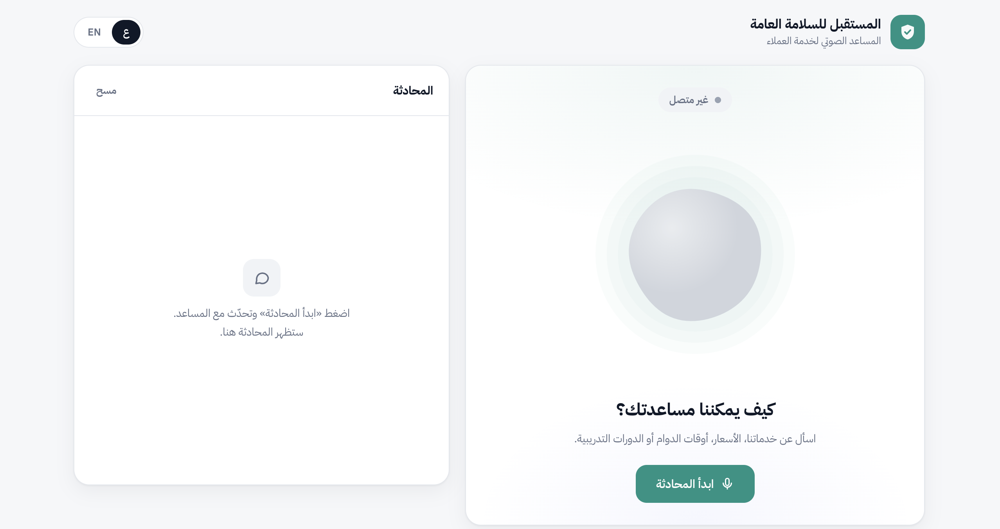
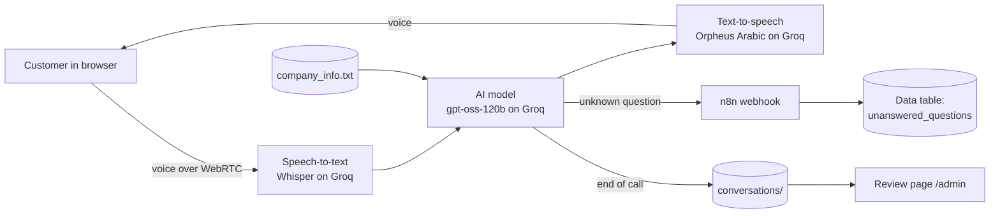

# CallCenterAi — Arabic AI Voice Assistant

A real-time **Arabic voice assistant for customer service**, built for *Al-Mustaqbal Public Safety*, a fictional safety company used for this demo. Customers talk to it in the browser. It answers from the company's own information, saves every call, and logs every question it could not answer so the knowledge base keeps growing.

> مساعد صوتي ذكي باللغة العربية لخدمة العملاء: بيسمع الزبون، وبيجاوبه بالصوت من معلومات الشركة، وبيحفظ المكالمات، وبيسجّل الأسئلة اللي ما عرف يجاوبها.

<!-- Screenshots: add images to docs/ and uncomment


-->

## Features

- **Live voice conversation in Arabic.** Speech-to-text, AI reply and text-to-speech in real time, with natural interruptions.
- **Answers only from company data.** The knowledge comes from one editable text file (`company_info.txt`). When the answer isn't there, the assistant says so and gives the company's phone number.
- **Unanswered-question logging.** The AI calls a tool that sends each unknown question to an **n8n** workflow, which stores it in a data table for review.
- **Call history.** Every finished call is saved, and a review page (`/admin`) lists and searches them. The customer's phone number is picked up automatically when they say it.
- **Bilingual web interface.** Arabic (RTL) and English, with an animated voice orb, live transcript and mute control.
- **Ready for deployment.** Docker Compose setup with automatic HTTPS through Caddy.

## How it works



## Tech stack

| Part | Technology |
| --- | --- |
| Voice pipeline | [Pipecat](https://github.com/pipecat-ai/pipecat) (Python) |
| Speech-to-text | Whisper large v3 turbo (Groq) |
| AI model | openai/gpt-oss-120b (Groq) |
| Text-to-speech | Orpheus Arabic, Saudi dialect (Groq) |
| Voice connection | WebRTC (aiortc) |
| Automation | n8n (webhook and data table) |
| Interface | HTML, CSS and JavaScript, no framework |
| Deployment | Docker Compose and Caddy (HTTPS) |

All three AI models run on **Groq's free tier**.

## Run it locally (macOS)

1. Get a free API key at [console.groq.com/keys](https://console.groq.com/keys).
2. In the Groq playground, accept the terms for `canopylabs/orpheus-arabic-saudi`.
3. Start the bot:
   ```bash
   chmod +x run.sh
   ./run.sh
   ```
4. Paste your Groq key when asked. It is saved locally in `.env`, which is never committed.
5. Open **http://localhost:7860/app/**, allow the microphone, and start talking.

| Page | Address |
| --- | --- |
| Voice assistant | `http://localhost:7860/app/` |
| Call review | `http://localhost:7860/admin` |

To test without a microphone, `.venv/bin/python text_test.py` sends three sample questions by text.

## Configuration

Settings live in `.env` (see `.env.example`):

| Variable | Purpose |
| --- | --- |
| `GROQ_API_KEY` | Groq API key (required) |
| `N8N_UNANSWERED_URL` | n8n webhook for unanswered questions (optional) |
| `ADMIN_PASSWORD` | Password for `/admin`, needed on a public server |
| `DOMAIN` | Your domain, for HTTPS on a server |

**n8n workflow:** a Webhook (POST) receives `{ question, customer_phone, conversation_id }`, checks that the question isn't empty, inserts a row into a data table, and returns `{ ok: true }`.

## Deploy on a server

See **[DEPLOY.md](DEPLOY.md)** for step-by-step instructions (in Arabic). In short:

```bash
git clone https://github.com/Aseel-Gharaibeh12/CallCenterAi.git
cd CallCenterAi
cp .env.example .env   # fill in your values
docker compose up -d --build
```

## Project structure

```
├── bot.py              # Voice pipeline, call saving, n8n tool, web routes
├── company_info.txt    # Company knowledge the assistant answers from
├── ui/
│   ├── index.html      # Voice assistant page
│   └── admin.html      # Call review page
├── text_test.py        # Text-only test, no microphone needed
├── run.sh              # One-command local setup and start (macOS)
├── Dockerfile, docker-compose.yml, Caddyfile   # Server deployment
└── DEPLOY.md           # Deployment guide (Arabic)
```

## Privacy

API keys and the n8n link stay in `.env`, and saved calls stay in `conversations/`. Both are excluded from Git. The assistant tells customers at the start of the call that the conversation is saved.

---

Built by [Aseel Gharaibeh](https://github.com/Aseel-Gharaibeh12) for learning purposes. The company and its details are fictional.
